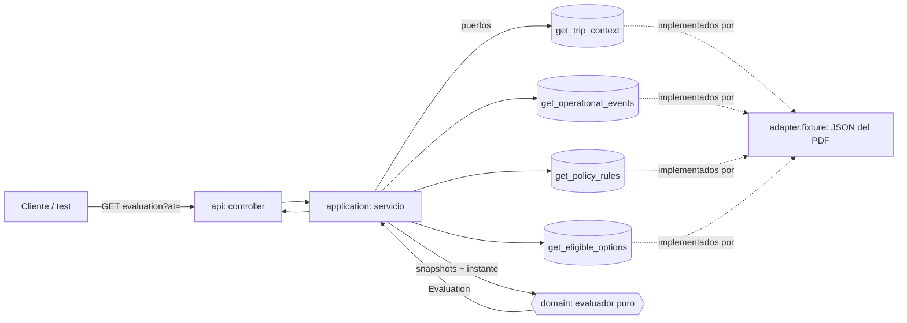
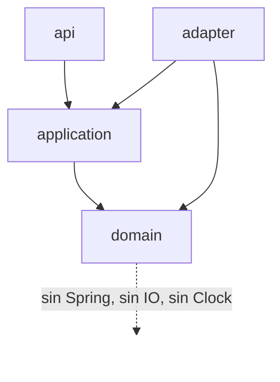

# Arquitectura — Disruption Companion (backend)

Autor: agente Architect de BMAD (Winston). Etiquetas: **[ADOPTADO]** ya decidido por el usuario en el análisis v0.2 · **[SUPUESTO]** propuesta mía, a corregir en la revisión · **[SIN VERIFICAR]** no se pudo comprobar en fuentes externas.

## 1. Qué se construye

Un único servicio Spring Boot con **una operación de lectura**: dado `bookingId` y un instante de referencia, consulta las 4 lecturas del PDF (mocks), evalúa R1–R5, resuelve fuentes contradictorias, valida vigencia de opciones y devuelve una **evaluación justificada y segura**. No escribe nada, no persiste, no usa IA en runtime [ADOPTADO: análisis §9, §13].



## 2. Paradigma y capas

**Functional core / imperative shell.** Toda la lógica de decisión vive en funciones puras sobre datos inmutables (`record`). El IO (4 lecturas) y el reloj quedan en la capa externa. Es lo que hace reproducibles los tests con instante fijo (C-7) y a AC-10 (determinismo) trivial.

| Capa | Paquete (`com.latam.disruption.…`) | Contiene | Puede depender de |
|---|---|---|---|
| Dominio | `domain` | modelos, `Tri`, evaluador, resolutor de fuentes, evaluador de opciones | solo JDK |
| Aplicación | `application` | puertos (interfaces), servicio de orquestación, proyección mínima | `domain` |
| Adaptadores | `adapter.fixture` | lectura de JSON del PDF → modelos de dominio | `application`, `domain` |
| API | `api` | controller, DTO de respuesta, manejo de errores | `application`, `domain` |



## 3. Invariantes y reglas

### AD-1 — Evaluador puro, sin reloj ni IO [ADOPTADO en parte: instante como parámetro]
- **Binds:** todo el paquete `domain`.
- **Prevents:** reglas que consultan `Instant.now()` o un puerto; tests dependientes del reloj.
- **Rule:** el evaluador es una función `evaluar(EvaluationInput) → Evaluation`. `EvaluationInput` incluye los 4 snapshots (con sus `retrievedAt`), `at: Instant` y `compensationRequested: boolean` (falso por defecto, S-7). `domain` no importa `org.springframework.*`. El único `Clock` vive en `api`/`application` y solo rellena `at` cuando el cliente no lo envía.

### AD-2 — Lógica tri-valor y reglas codificadas por `rule_id`
- **Binds:** AC-1, AC-2, AC-8 (documentado).
- **Prevents:** un parser de condiciones genérico; un `false` por defecto cuando falta información.
- **Rule:** toda condición devuelve `Tri {TRUE, FALSE, UNKNOWN}` con AND de Kleene (`FALSE AND UNKNOWN = FALSE`). R1–R5 se implementan como código explícito, una por `rule_id`. Si el `rule_id` es desconocido, o la `condition` recuperada no coincide literalmente con el texto conocido, la regla vale `UNKNOWN` y **no confirma ningún derecho**. Sin parser, sin motor externo.
- **Reglas aplicadas:**

| Regla | Condición evaluada | Resultado |
|---|---|---|
| R1 | `delay >= 180` | `UNKNOWN` si el estado del vuelo es incierto; si no, comparación directa (S-3) |
| R2 | `delay >= 240 AND international` | `international` se deriva de aeropuertos con tabla fija SCL/LIM/MEX → país (S-8); aeropuerto fuera de la tabla → `UNKNOWN` |
| R3 | `missed_connection` | conexión **en riesgo** → `UNKNOWN`; sin riesgo → `FALSE`. Nunca `TRUE`: el PDF no trae un dato explícito de "perdida" |
| R4 | `compensation_requested` | valor del parámetro (falso por defecto) |
| R5 | `group_includes_minor` | `TRUE` si algún pasajero es `CHILD` o `age < 18`; si tipo y edad son incoherentes → `UNKNOWN` (S-6) |

### AD-3 — Derecho confirmado ≠ concedido ≠ ejecutado
- **Binds:** AC-1, AC-2.
- **Prevents:** presentar R5 o R4 como beneficio otorgado; ejecutar acciones.
- **Rule:** una regla `TRUE` produce un derecho en estado `CONFIRMED` si `requires_human_approval=false`, o `PENDING_APPROVAL` si es `true`. Ningún estado significa "concedido" ni "ejecutado". El campo `actionsExecuted` de la respuesta es siempre `[]` (C-5). Derechos duplicados (R1 y R3 → `REBOOK_NO_FEE`) se deduplican por `entitlement`.

### AD-4 — Contrato de salida: dos booleanos más motivos [ADOPTADO: aprobado 2026-11-04]
- **Binds:** AC-1…AC-6, `api`.
- **Prevents:** enums de estado adicionales (el usuario pidió un resultado simple); respuestas sin justificación.
- **Rule:** la respuesta lleva `recommendationSupported`, `humanInterventionRequired`, `reasons[]` (cada uno con `code` y referencias a evidencia) y las secciones `flight`, `connections`, `rules`, `entitlements`, `options`, `policy`, `meta`, `actionsExecuted`.
  - `recommendationSupported = true` **solo si** se cumplen las cuatro: política verificada · estado del vuelo resuelto · existe un derecho `CONFIRMED` · ninguna regla `UNKNOWN` cuyo derecho no esté ya confirmado por otra regla (C-1).
  - `humanInterventionRequired = !recommendationSupported OR existe derecho PENDING_APPROVAL`.
  - [ADOPTADO] Con R1 `TRUE` y R5 `TRUE` ambos booleanos son `true`: la recomendación está respaldada pero un derecho adicional espera aprobación.

### AD-5 — Resolución de fuentes por segmento [ADOPTADO: aprobado 2026-11-04, incluida la contradicción desde fuente degradada]
- **Binds:** AC-3, AC-1.
- **Prevents:** que un evento degradado o viejo pise a uno sano y reciente, o al revés sin avisar.
- **Rule:** por segmento, el retraso vigente es el `DELAY` más reciente de fuentes no degradadas. Cada `STATUS ON_TIME` se compara con ese `DELAY`:
  - más antiguo que el `DELAY` → se **descarta con motivo** (`SUPERSEDED`, o `DEGRADED_AND_OLDER` si su fuente está degradada);
  - más reciente que el `DELAY` (sana o degradada) → contradicción: el segmento queda `UNCERTAIN`, ambos eventos se listan con motivo y no hay recomendación definitiva.
  `STATUS SCHEDULED` no contradice un `DELAY`. `GATE_CHANGE` es informativo (S-4). Segmento sin ningún evento → `NO_INFORMATION`, nunca "a tiempo". Sin umbral de frescura: el PDF no lo define.

### AD-6 — Conexión proyectada, nunca confirmada [ADOPTADO: análisis §13]
- **Binds:** AC-1.
- **Prevents:** afirmar "perdiste tu conexión".
- **Rule:** para cada par de segmentos consecutivos, `llegada proyectada = llegada programada + retraso` (S-3) y `déficit = llegada proyectada − salida siguiente`. Déficit > 0 → `AT_RISK` con `confirmed=false`. No se aplica tiempo mínimo de conexión (el PDF no lo define). Se asume un único marco horario (S-1) y se calcula con `LocalDateTime` (fecha del segmento + hora).

### AD-7 — Opciones: estado por opción, vigencia por TTL [ADOPTADO: vencidas se listan como requieren revalidación, aprobado 2026-11-04]
- **Binds:** AC-4, AC-5.
- **Prevents:** proponer una opción que separa al grupo, vencida o no verificable.
- **Rule:** `validUntil = options.retrievedAt + ttl_seconds`; vencida si `at >= validUntil`. Cada opción recibe un único `status`, evaluado en este orden:
  1. `type=REFUND` → `NOT_VERIFIABLE` (política `POL-REFUND-2026-01` sin consultar, C-4), sin considerar `refundable:false`.
  2. `policy_ref` distinto de la versión de política recuperada para opciones de demora → `NOT_VERIFIABLE`.
  3. `seats_available < nº de pasajeros` → `NOT_SUITABLE_GROUP` (C-3: no se separa al grupo).
  4. Vencida → `REQUIRES_REVALIDATION`.
  5. En otro caso → `CANDIDATE`.
  Si falta `change_penalty_amount` (`missing_fields`), el costo se muestra como `TO_CONFIRM`; nunca se afirma un costo de cambio.

### AD-8 — Matriz de fallos: error controlado, nada inventado [ADOPTADO: D-24; filas por derivación]
- **Binds:** AC-7 (stretch).
- **Prevents:** evaluaciones con datos inventados; excepciones sin forma.
- **Rule:** los puertos lanzan `DependencyUnavailableException(dependencia)`. El servicio aplica:

| Dependencia caída | Resultado HTTP | Contenido |
|---|---|---|
| `get_trip_context` | 503, `ProblemDetail` | sin evaluación |
| `get_operational_events` | 503, `ProblemDetail` | no se afirma retraso |
| `get_policy_rules` | 200 | solo hechos, sin derechos, `recommendationSupported=false` |
| `get_eligible_options` | 200 | derechos sin opciones, `options.status=UNAVAILABLE` |

### AD-9 — Datos personales no entran al dominio [ADOPTADO: C-6]
- **Binds:** AC-6, `adapter`, `api`, logs.
- **Prevents:** fuga de PII en respuesta, logs o hacia un modelo futuro.
- **Rule:** el modelo de dominio de pasajero es solo `passengerId`, `type`, `age`. El adaptador no mapea `name`, `email`, `phone`, `document_id` ni `loyalty_tier`, así que **no pueden** llegar a la salida. Los logs registran solo IDs (booking, segmento, regla, evento). Ningún `toString` de dominio incluye campos personales.

### AD-10 — Escrituras fuera del código [ADOPTADO: C-5]
- **Binds:** `application`, `adapter`.
- **Prevents:** efectos laterales accidentales.
- **Rule:** no existen puertos ni clases para `create_rebooking_request`, `create_human_case` ni `notify_passenger`. Su diseño vive en `03-diseno-complementario.md` §4. Supuestos aprobados para ese diseño: (1) crear un caso humano admite reintentos seguros sin confirmación del pasajero; (2) un reintento de la misma solicitud de rebooking reutiliza la misma `idempotency_key`.

## 4. Convenciones

| Concern | Convención |
|---|---|
| Nombres | clases en inglés; códigos de motivo y estados en `UPPER_SNAKE`; IDs del PDF tal cual (`R1`, `E-1001`, `S1`, `O1`) |
| Tiempos | `Instant` UTC en toda la API y el dominio, ISO-8601; horas `HH:mm` de segmentos se combinan con la fecha en `LocalDateTime` (S-1) |
| Modelos | `record` inmutables; colecciones inmutables; `Optional` solo en retornos, no en campos |
| Errores | `ProblemDetail` (RFC 9457) con `code` estable; 4xx por entrada inválida (instante mal formado), 503 por dependencia |
| Logging | solo IDs; un log `INFO` por evaluación con `bookingId`, `at`, `supported`, `humanRequired` |
| Config | sin perfiles; el adaptador de fixtures es el único; tabla aeropuerto→país en `application.yml` |
| Tests | instante fijo explícito en cada test; sin `@SpringBootTest`; dominio y servicio sin contexto de Spring |

## 5. Stack

| Nombre | Versión | Estado |
|---|---|---|
| Java | 21 (OpenJDK 21.0.9 local) | verificado en tu máquina |
| Gradle | 9.2.1 (local; Maven no está instalado) | verificado en tu máquina |
| Spring Boot | 4.1.x (4.1.1 en la caché local); plan B 4.0.8 | **[SIN VERIFICAR en web]**: la búsqueda web está bloqueada por una política de la organización. Elección del usuario, con regreso a 4.0.8 si hay problemas |
| Spring Framework | 7.0.9 | leído del BOM local de Boot 4.1.1 |
| Jackson | 3.1.5 (`tools.jackson`) | leído del BOM local |
| JUnit Jupiter / AssertJ | 6.0.3 / 3.27.7 | leído del BOM local |

El nombre exacto de los starters en Boot 4 (`spring-boot-starter-web` frente a `-webmvc`) se comprueba al crear el proyecto (Plan, paso 0). Boot 4 modularizó los starters de test y puede no resolver `spring-boot-starter-test` como en 3.x; por eso AD-11.

### AD-11 — Tests sin contexto de Spring
- **Binds:** AC-1…AC-6.
- **Prevents:** perder tiempo con la API de test de Boot 4, no verificada.
- **Rule:** AC-1…AC-6 se prueban contra `domain` y `application` con JUnit + AssertJ. El caso HTTP (AC-7, 503) usa `MockMvcBuilders.standaloneSetup`, si hay tiempo.

## 6. Semilla estructural

```text
disruption-companion/
  build.gradle.kts, settings.gradle.kts
  src/main/java/com/latam/disruption/
    domain/        Tri, modelos (record), DisruptionEvaluator, FlightStateResolver,
                   RuleEvaluator, OptionEvaluator, ConnectionAnalyzer
    application/   puertos (4), DisruptionEvaluationService, DependencyUnavailableException
    adapter/fixture/  lectores JSON → dominio (sin campos PII)
    api/           EvaluationController, EvaluationResponse, ApiExceptionHandler
  src/main/resources/fixtures/abc123/   trip-context.json, events.json, options.json, policy-delay.json
  src/test/java/.../   un test por AC + TestData (builders de escenarios sintéticos)
```

**Salida esperada del caso base** (`at = 2026-09-15T11:03:00Z`), abreviada:

```json
{
  "bookingId": "ABC123",
  "evaluatedAt": "2026-09-15T11:03:00Z",
  "recommendationSupported": false,
  "humanInterventionRequired": true,
  "reasons": [
    {"code": "CRITICAL_RULE_UNKNOWN", "ruleId": "R3"},
    {"code": "APPROVAL_PENDING", "ruleId": "R5"},
    {"code": "OPTION_COST_TO_CONFIRM", "optionId": "O1"}
  ],
  "flight": {
    "segments": [
      {"segmentId": "S1", "state": "DELAYED", "delayMinutes": 160, "newDeparture": "17:10",
       "basis": {"eventId": "E-1001", "source": "OPS_CORE", "recordedAt": "2026-09-15T10:48:00Z"}},
      {"segmentId": "S2", "state": "NO_DELAY_REPORTED"}
    ],
    "discardedEvents": [{"eventId": "E-1012", "reason": "DEGRADED_AND_OLDER", "source": "LEGACY_MIRROR"}],
    "informationalEvents": [{"eventId": "E-1007", "type": "GATE_CHANGE"}]
  },
  "connections": [{"from": "S1", "to": "S2", "status": "AT_RISK", "confirmed": false,
                   "projectedArrival": "20:35", "nextDeparture": "19:05", "deficitMinutes": 90}],
  "rules": [
    {"ruleId": "R1", "result": "FALSE"}, {"ruleId": "R2", "result": "FALSE"},
    {"ruleId": "R3", "result": "UNKNOWN"}, {"ruleId": "R4", "result": "FALSE"},
    {"ruleId": "R5", "result": "TRUE", "entitlement": "PRIORITY_HANDLING", "state": "PENDING_APPROVAL"}
  ],
  "options": [
    {"optionId": "O1", "status": "CANDIDATE", "cost": "TO_CONFIRM", "validUntil": "2026-09-15T11:04:35Z"},
    {"optionId": "O2", "status": "NOT_SUITABLE_GROUP"},
    {"optionId": "O3", "status": "NOT_VERIFIABLE"}
  ],
  "policy": {"version": "POL-DELAY-2026-03", "effectiveFrom": "2026-03-01", "verified": true},
  "meta": {"tripRetrievedAt": "2026-09-15T11:02:31Z", "eventsRetrievedAt": "2026-09-15T11:02:33Z",
           "optionsRetrievedAt": "2026-09-15T11:02:35Z", "policyRetrievedAt": "2026-09-15T11:02:36Z"},
  "actionsExecuted": []
}
```

Endpoint: `GET /api/v1/bookings/{bookingId}/disruption-evaluation?at=<ISO-8601>&compensationRequested=false` [SUPUESTO]. Sin `at` usa el reloj del sistema.

## 7. Mapa AC → arquitectura

| AC | Vive en | Gobernado por |
|---|---|---|
| AC-1 Caso base | `DisruptionEvaluator` completo | AD-2, 3, 4, 5, 6, 7 |
| AC-2 R1 + frontera 179/180, escenario 200 min | `RuleEvaluator` | AD-2, 3, 4 |
| AC-3 Fuente contradictoria | `FlightStateResolver` | AD-5 |
| AC-4 Grupo | `OptionEvaluator` | AD-7 |
| AC-5 TTL | `OptionEvaluator` + instante de entrada | AD-1, AD-7 |
| AC-6 Evidencia y PII | modelo de salida, adaptadores | AD-4, AD-9 |
| AC-7…AC-10 | solo documentados (AC-7 stretch, AC-10 cubierto por AD-1) | AD-8 |

## 8. Aplazado (con el motivo)

| Tema | Por qué puede esperar |
|---|---|
| Despliegue, ambientes, infraestructura, CI | el PDF excluye despliegue; el slice corre con `./gradlew bootRun` o solo tests |
| Autenticación y autorización | fuera de alcance (C-8); queda en la lista previa a producción (análisis §12) |
| Persistencia, caché, reintentos | sin estado en el slice |
| Observabilidad más allá de logs con IDs | sin operación real |
| Tiempo mínimo de conexión, "conexión perdida" explícita, umbral de frescura | el PDF no los define; validar con Operaciones |
| Medianoche, retrasos acumulados, eventos de tipo desconocido, infante sin asiento | documentados en `03-diseno-complementario.md` §5 |
| Adaptadores reales de las 4 lecturas | los contratos del PDF se conservan en los puertos; cambia solo el adaptador |

## 9. Alternativas descartadas y puntos para tu aprobación

| Decisión | Elegida | Descartadas y por qué |
|---|---|---|
| Paradigma | núcleo puro + puertos mínimos | **Hexagonal completo con un caso de uso por regla**: más archivos que valor en 3 h (Rule of Three: no hay tres variantes aún). **Motor de reglas (Drools) o parser de condiciones**: el análisis lo excluye y R1–R5 son 5 reglas |
| Estructura | un módulo Gradle, paquetes por capa | **Multimódulo**: costo de build sin beneficio a este tamaño |
| Datos de entrada | JSON de fixtures del PDF tras puertos | **Mocks en memoria hardcodeados en el servicio**: mezclaría datos con lógica; **WireMock**: dependencia extra sin necesidad |
| Salida | 2 booleanos + motivos | **Enum de estados** (como D2 de v0.1): el usuario pidió algo simple |
| Pruebas | dominio y servicio sin Spring | **`@SpringBootTest`**: más lento y con API de test de Boot 4 sin verificar |

## 10. Aprobación (2026-11-04)

El usuario aprobó la arquitectura. Resolución de los 5 puntos:

| # | Punto | Resolución |
|---|---|---|
| 1 | AD-4: R1 y R5 verdaderas | ambos booleanos en `true` |
| 2 | AD-5: contradicción de fuentes | incertidumbre, aunque el evento venga de fuente degradada |
| 3 | AD-7: opciones vencidas | se listan como `REQUIRES_REVALIDATION` |
| 4 | AC-2: escenario de 200 min | incluye variante sin menor para probar ambos comportamientos |
| 5 | Spring Boot | 4.1.x; si genera problemas, volver a 4.0.8 (sigue **sin verificar en web**) |

Supuestos adicionales aprobados (afectan solo al diseño de escrituras, §4 de `03`): crear un caso humano admite reintentos seguros sin confirmación, y un reintento de la misma solicitud de rebooking mantiene la misma `idempotency_key`.

**Prioridad de ejecución:** backend funcional, sus pruebas principales y la documentación obligatoria. Lo demás es stretch.
