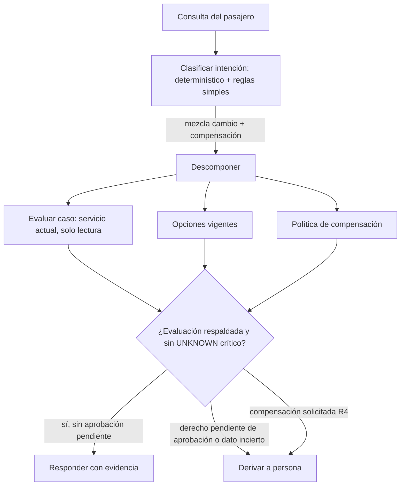

# Diseño complementario (solo diseño, sin implementar) — Disruption Companion

**Estado:** aprobado por el usuario (2026-11-04), con los dos supuestos de §4 · **Fecha:** 2026-11-04 · **Autor:** agente Architect de BMAD (Winston)
Cubre lo que el PDF pide como diseño (§5.2 consulta ambigua, §5.3 capa complementaria) y la tabla de clasificación del README. Lo no implementado se dice como tal.

## 1. Clasificación de pasos

| Paso | Clasificación | Razón | Riesgo | Control / fallback |
|---|---|---|---|---|
| Lectura de reserva, eventos, políticas y opciones | determinístico | contratos fijos, sin juicio | datos parciales o viejos | marcas `retrievedAt`, `completeness`, TTL; matriz de fallos (AD-8) |
| Resolución de fuentes contradictorias | determinístico | regla explícita y auditable (AD-5) | regla demasiado simple | ante duda, vuelo `UNCERTAIN` y revisión humana |
| Evaluación de R1–R5 | determinístico | condiciones cerradas; verificable con tests de frontera | política cambia de versión | `UNKNOWN` si la versión o la condición no coincide (AD-2) |
| Filtrado de opciones (grupo, TTL, REFUND) | determinístico | datos y umbrales objetivos | opción vencida mostrada como vigente | revalidación obligatoria (AD-7) |
| Decisión de «recomendación respaldada» | determinístico | combinación booleana de lo anterior | falso positivo | las 4 condiciones de AD-4; `UNKNOWN` bloquea |
| Aprobación de R4/R5, rebooking, compensación | human | exigido por la política [PDF p.3] y alto impacto | acción sin control | no se ejecuta; solo se recomienda (C-5) |
| Consulta ambigua: descomposición y síntesis | agentic (diseño, §2) | combina fuentes abiertas | alucinar un derecho | solo lectura, salida validada contra el evaluador, tope de pasos |
| Redacción del mensaje al pasajero | AI-assisted (diseño, §3) | texto natural; contenido fijado por el evaluador | afirmar algo no validado | plantilla con campos obligatorios; `policy_ref` exigido |
| Diseño y revisión de este proyecto | AI-assisted | IA propone, el usuario decide | error factual de la IA | revisión humana, bitácora |

**Qué quedó sin IA en runtime:** todo lo implementado. El beneficio esperado de un modelo no justifica su costo, latencia ni el riesgo de «inventar derechos» en un caso donde la exactitud es el objetivo [PDF p.5].

## 2. Consulta ambigua o compleja (diseño)

Ejemplo: *«Mi vuelo se retrasó, ¿puedo cambiar a otro que salga hoy y que me paguen algo por las molestias?»*

| Aspecto | Diseño |
|---|---|
| Qué es determinístico | todas las reglas, el filtrado de opciones, la vigencia, el chequeo «¿respaldada?» (el evaluador actual) |
| Qué podría usar IA | (a) clasificar la intención de una frase libre (cambio, reembolso, compensación, información); (b) redactar la respuesta a partir de los hechos validados |
| Contexto que recibe un modelo | la `Evaluation` ya proyectada: IDs, estados, cifras. **Nunca** nombre, email, teléfono, documento ni datos de menores |
| Herramientas y permisos | solo las 4 lecturas; sin escritura; mínimo privilegio |
| Dónde se detiene | `recommendationSupported=false`, regla `UNKNOWN` crítica, R4 solicitada, derecho `PENDING_APPROVAL`, opción vencida, o intención no clasificable |
| Cómo se detecta una salida incorrecta | un validador determinístico compara el texto generado con la `Evaluation`: cada monto, derecho y opción mencionados deben existir en ella; si no, se descarta el texto y se usa la plantilla fija |
| Tope | 1 clasificación + 1 redacción por consulta; sin bucles de agente |

## 3. Mensaje al pasajero (especificación)

Principio: nunca decir más de lo verificado, y decir qué sigue. Sin PII en el texto salvo el nombre de pila si el canal lo exige (decisión de Seguridad, pendiente).

| Situación | Plantilla (idea, no texto final) | Campos obligatorios |
|---|---|---|
| Caso base (incierto + aprobación pendiente) | «Tu vuelo LA500 sale ahora a las 17:10 (retraso de 160 min). Tu conexión LA2410 podría verse afectada; aún no está confirmado. Estamos revisando tu caso con una persona del equipo: prioridad para tu grupo con menor, sujeta a aprobación. Hay una alternativa que se podría ofrecer; te confirmamos disponibilidad y costo.» | vuelo, retraso, fuente y hora del dato, qué está pendiente, `policy_ref` |
| Derecho confirmado (R1) | «Por el retraso, puedes cambiar tu vuelo sin costo de cambio. Estas opciones están disponibles hasta las HH:mm…» | derecho, versión de política, vigencia de opciones |
| Opciones vencidas | «Las opciones que te mostramos ya no están garantizadas; las verificamos de nuevo.» | — |
| Dependencia caída | «No pudimos confirmar el estado de tu vuelo. Intenta de nuevo en unos minutos o contacta a un agente.» | — |

Reglas: sin `policy_ref` no se envía (la tool devuelve 422); no se menciona un costo si es `TO_CONFIRM`; no se promete reembolso ni compensación (O3 y R4 no verificadas).

## 4. Escrituras (diseño)

Ninguna se ejecuta en el slice (C-5). Cuando se implementen, el servicio de evaluación sigue siendo de solo lectura y una capa aparte decide ejecutar.

| Tool | Cuándo | Control | Fallos |
|---|---|---|---|
| `create_human_case` | `humanInterventionRequired=true` | motivo = `reasons[]`, evidencia = IDs (sin PII); cola `DISRUPTION_L2`; sin confirmación del pasajero | 201 → guardar `case_id`; error → **reintento seguro sin confirmación [SUPUESTO aprobado 2026-11-04]**. El PDF no dice si la tool deduplica: validar con el Eng Lead |
| `create_rebooking_request` | pasajero elige una opción **vigente** y no hay aprobación pendiente | `idempotency_key` derivada de (booking, opción) y **la misma clave en todo reintento de esa solicitud [aprobado 2026-11-04]**; clave nueva solo para una solicitud distinta; revalidar TTL justo antes del primer envío; confirmación del pasajero | 409 → leer `request_id` existente, no reintentar; **503 = indeterminado**: reintentar solo con la misma clave (el 409 evita el duplicado) o consultar estado/escalar a persona; nunca con clave nueva |
| `notify_passenger` | solo mensajes validados con `policy_ref` | plantilla fija (§3) | 422 → bug de contenido, no reintentar; 202 → registrar `notification_id` |

Reglas transversales: ninguna escritura sin `policy_ref` y sin evidencia trazable; R4 y R5 requieren aprobación humana registrada antes de cualquier acción derivada.

## 5. Casos borde documentados (no implementados)

| Caso | Tratamiento propuesto |
|---|---|
| Evento sin segmento o de tipo desconocido | se ignora y se lista como `UNRECOGNIZED_EVENT`; no cambia el estado |
| Segmento sin eventos | `NO_INFORMATION`, nunca «a tiempo» |
| `delay_minutes` ≠ `new_departure − salida programada` | `UNCERTAIN`; no recomendación (C-1) |
| `policy_ref` de opción ≠ política recuperada | opción `NOT_VERIFIABLE` (AD-7); AC-8 |
| Versión de política superada | si el `version` recuperado figura en `superseded_versions`, no se confirma ningún derecho |
| Menor sin adulto; tipo y edad incoherentes; infante sin asiento | R5 `UNKNOWN`; revisión humana |
| Opciones con campos ausentes (polimórficas) | campo ausente → atributo `UNKNOWN`; opción `NOT_VERIFIABLE` |
| Retraso que cruza la medianoche | el modelo `LocalDateTime` lo soporta si se suma el retraso a la fecha; se verifica en tests futuros |
| O1 sale el día siguiente | el PDF no define alojamiento; se informa sin derechos adicionales |
| Retraso que crece de 160 a ≥180 | la evaluación depende de `at`; revalidar si el dato supera su vigencia |
| `change_penalty_amount` ausente | costo `TO_CONFIRM` (AC-9, ya cubierto en AD-7) |

## 6. Validar antes de producción

Es la lista del análisis v0.2 §12; este diseño añade dos puntos: (1) política de datos de pasajero en el mensaje (¿nombre de pila?) con Seguridad; (2) semántica del 503 de `create_rebooking_request` con el Eng Lead.
